# RuyaShield Technical Blueprint

Version 2.0 · 2026-10-29 · companion to RuyaShield_PRD_v2.0_Implementation_Ready.docx (§6, §8–§13).

> AI-assisted draft. Proposed design only: no application code exists yet. Every API is a proposed contract. The WebMonitor section is a provisional adapter (DEP-WM-01). Numbers marked "assumption" are provisional.

## Contents

1. Principles and constraints
2. System context and containers
3. Trust boundaries
4. Modules
5. Architecture decision records
6. State machines
7. AI gateway
8. FixProof
9. Sandbox and egress guard
10. Data model
11. API conventions and endpoints
12. Events
13. WebMonitor adapter (provisional)
14. Open technical decisions

## 1. Principles and constraints

- Evidence before claims.
- Authorization before scanning.
- Read-only by default.
- Human approval before production changes.
- Independent verification before marking a fix verified.
- Least privilege and tenant isolation throughout.
- Transparent limitations and no blanket security guarantees.
- Measure verified outcomes, not scan volume.
- Testing only of explicitly authorized, verified (or attested) assets within an approved, versioned scope.
- Check classes: **P** passive, **A1** active-safe, **A2** approval-required (flag off in MVP), **X** prohibited (never executable).
- RuyaShield opens pull requests only. It never merges or deploys.
- Failed, inconclusive, error and not_run results are never shown as passed.

Stack (from v1.1): Next.js 16+, React 19, TypeScript, Tailwind; PostgreSQL (ORM per D-02) with RLS; OIDC identity provider (D-04); AWS: SQS + outbox, private S3 with SSE-KMS, Secrets Manager, KMS; isolated workers.

## 2. System context and containers

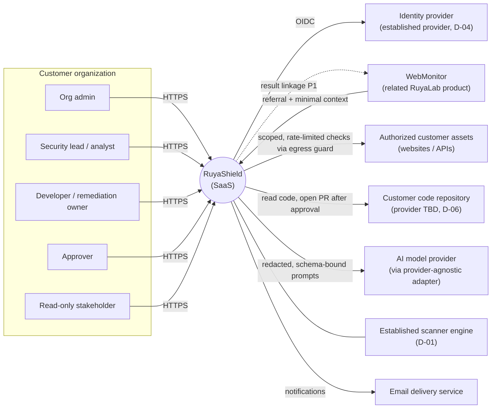

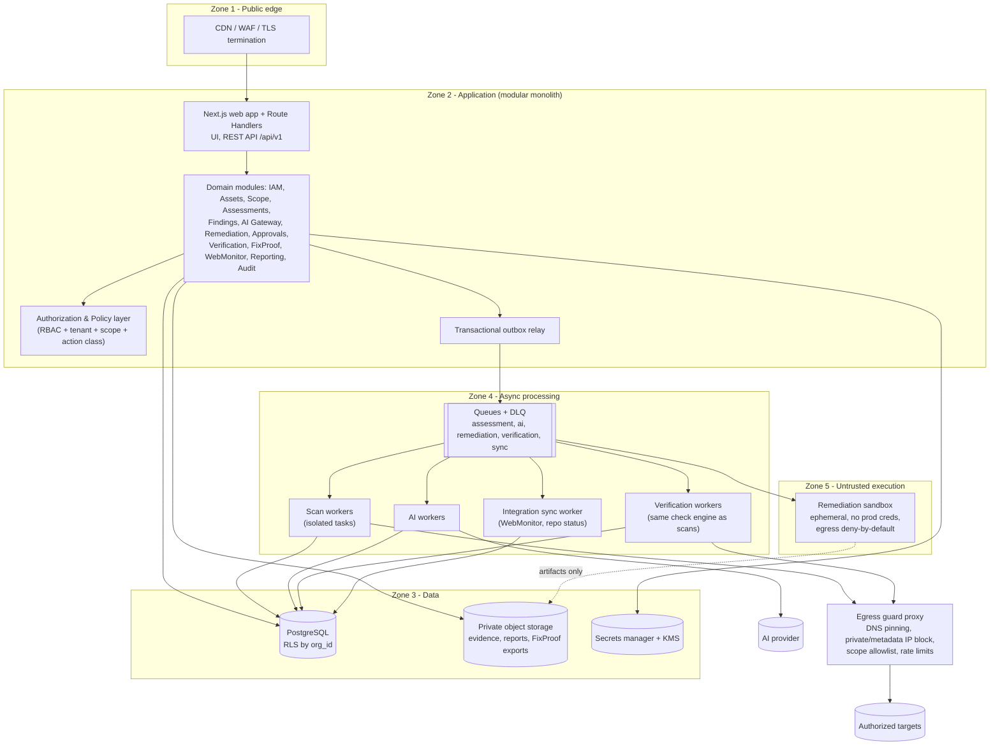

## 3. Trust boundaries

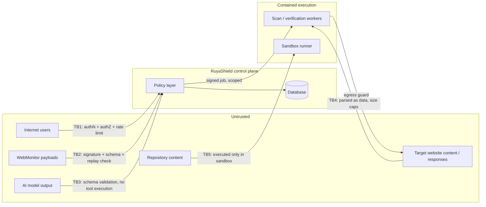

| ID | Boundary | Data crossing | Controls |
|---|---|---|---|
| TB-1 | Internet ↔ Web/API | Untrusted users and browsers | OIDC sessions, CSRF, CSP, rate limits, input validation, WAF |
| TB-2 | Web/API ↔ Postgres | Tenant data | RLS keyed on org_id set per transaction, least-privilege DB roles, no superuser at runtime |
| TB-3 | Web/API ↔ Queue ↔ Workers | Job messages | Outbox, signed job envelopes carrying org_id + scope version, per-worker IAM roles |
| TB-4 | Scan workers ↔ Customer targets | Untrusted target responses | Egress guard: resolve-and-pin, deny private/metadata ranges, scope allowlist, rate/time budgets |
| TB-5 | Sandbox ↔ everything | Untrusted customer code + AI patches | Ephemeral isolated runtime, no prod credentials, deny-by-default egress (registry allowlist), artifacts out only |
| TB-6 | AI worker ↔ Model provider | Redacted tenant data; untrusted model output | Redaction, no tools, schema validation, output never executed, budget caps |
| TB-7 | Integrations ↔ Repo provider / WebMonitor | Third-party APIs and webhooks | Least-privilege app installation, webhook signature check, short-lived tokens in Secrets Manager |
| TB-8 | Operators ↔ Production | Platform staff | Break-glass with reason + time limit + audit, no standing access to tenant evidence |

## 4. Modules

| Module | Responsibility | Runs in | Epics |
|---|---|---|---|
| iam | Users, orgs, memberships, client groups, roles, sessions, MFA/step-up checks | Web/API | IAM |
| policy | Single authorization decision point (RBAC + tenancy + action class + kill switch) | Web/API, workers | IAM, SCOPE |
| assets | Assets, verification proofs, attestations, re-verification scheduler | Web/API, verifier worker | ASSET |
| scope | Versioned scopes, check catalogue, action classes | Web/API | SCOPE |
| assessments | Launch, orchestration, leases, status, quotas | Web/API, orchestrator | ASSESS, ADMIN |
| scanning | Scanner adapter + native checks; runs only in scan workers behind egress guard | Scan worker | ASSESS |
| findings | Normalization, fingerprint dedup, evidence, lifecycle, triage, risk acceptance | Web/API, workers | FIND, RISK, COLLAB |
| ai | AI gateway: redaction, prompt registry, schema validation, budget, provenance; no tools | AI worker | AI |
| remediation | Plans, code changes, sandbox orchestration, repo integration (PR-only) | Web/API, sandbox runner | REMED |
| approvals | Content-bound approvals, step-up, expiry, invalidation | Web/API | APPR |
| verification | Verification runs, FixProof assembly, export, hash chain | Workers | FIXP, AUDIT |
| integrations | WebMonitor adapter (provisional), repo provider, notifications | Web/API, workers | WMON, DASH |
| audit | Append-only audit events, hash chain, viewer/export | All | AUDIT |
| platform | Outbox, queue consumers, idempotency, observability, retention jobs | All | PLAT |

Rule: modules talk only through their public service interfaces and domain events, enforced by lint rules on import paths. Every database access sets `app.org_id` with `SET LOCAL` inside the transaction so that RLS applies.

## 5. Architecture decision records

### ADR-001 Modular monolith with isolated workers

- **Decision:** One Next.js/TypeScript codebase with enforced module boundaries; scanning, sandbox and AI run as separate worker processes with their own IAM roles.
- **Rationale:** Small team, simpler ops; isolation where it matters (v1.1 §7.3).
- **Consequences:** Extract services only for isolation, scale or ownership reasons.
- **Status:** Accepted (proposed) · *Confirmed from existing PRD*

### ADR-002 PostgreSQL with row-level security for tenancy

- **Decision:** Every tenant table has org_id; RLS policies + app-layer policy checks (defence in depth).
- **Rationale:** Cross-tenant leakage is a release blocker.
- **Consequences:** ORM choice D-02 must support SET LOCAL per transaction.
- **Status:** Proposed · *Recommended addition*

### ADR-003 SQS + transactional outbox, idempotent consumers

- **Decision:** State change and outbox row in one transaction; relay publishes; consumers dedupe on idempotency key.
- **Rationale:** No duplicate jobs, findings or usage (NFR idempotency).
- **Consequences:** At-least-once semantics everywhere.
- **Status:** Proposed · *Confirmed from existing PRD (SQS) + Recommended addition*

### ADR-004 Egress guard for all target traffic

- **Decision:** All scanner/verifier HTTP/DNS/TLS goes through a guard that resolves, pins and checks IPs against scope and deny lists.
- **Rationale:** SSRF and out-of-scope scanning prevention (SEC).
- **Consequences:** Adds latency; scanner engine must support proxying (D-01 criterion).
- **Status:** Proposed · *Recommended addition*

### ADR-005 Ephemeral sandbox for patch tests

- **Decision:** Container or microVM per run (D-05), 20 min cap, no credentials, registry-only egress.
- **Rationale:** RCE containment (v1.1 §8.2).
- **Consequences:** Some test suites will not run; result test_failed(reason) not passed.
- **Status:** Proposed · *Confirmed from existing PRD + Recommended addition*

### ADR-006 AI gateway without tools

- **Decision:** Model receives redacted data and returns schema-validated JSON; it cannot call tools, network or shell.
- **Rationale:** Prompt injection cannot cause actions.
- **Consequences:** Less "agentic"; acceptable by design.
- **Status:** Proposed · *Confirmed from existing PRD (tool policy outside model) + Recommended addition*

### ADR-007 Hash-chained audit and FixProof records

- **Decision:** SHA-256 chain per org over canonical JSON; periodic anchor digest stored separately.
- **Rationale:** Tamper evidence for client-facing proof.
- **Consequences:** Tamper-evident only; WORM is D-11.
- **Status:** Proposed · *Recommended addition*

### ADR-008 PR-only remediation

- **Decision:** RuyaShield opens PRs after approval; never merges, deploys, or holds admin scopes.
- **Rationale:** Removes production-change risk (RB-03).
- **Consequences:** Customer must merge; verification waits for merge observation.
- **Status:** Proposed · *Confirmed from existing PRD (approval before merge) + Recommended addition*

### ADR-009 Content-bound approvals

- **Decision:** Approval binds to subject_sha256 of RFC 8785 canonical JSON of plan + diff; any change invalidates.
- **Rationale:** Prevents approve-then-swap.
- **Consequences:** Edits require re-approval.
- **Status:** Proposed · *Recommended addition*

## 6. State machines

Action types: **RO** Read-only (Changes RuyaShield state only; no traffic to or change on customer systems.); **RT** Read-only (target contact) (Sends non-mutating requests (P/A1 checks) to an authorized, in-scope asset through the egress guard.); **AR** Approval-required (Cannot happen without a valid, unexpired, content-bound approval by an eligible approver.); **TM** Target-modifying (Changes something the customer owns (e.g. opens a PR in their repository). Always also AR in RuyaShield.). A transition that is not listed returns `422 transition_not_allowed`.

### Assessment

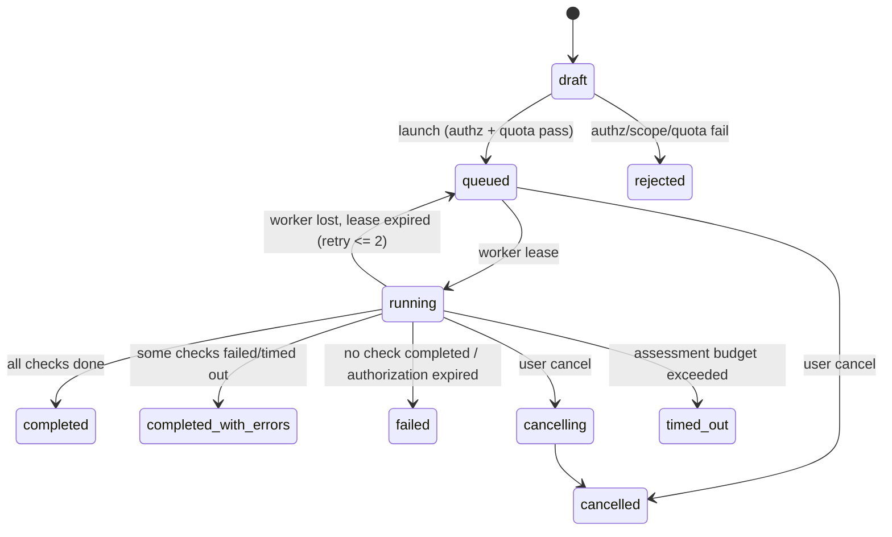

| From | To | Trigger / guard | Actor | Type |
|---|---|---|---|---|
| draft | queued | Launch: authz, scope, verification, quota and kill-switch checks pass | analyst / security_lead | RO |
| draft | rejected | Any pre-check fails (403/409/423/429 returned to caller) | system | RO |
| queued | running | Worker obtains lease | service | RT |
| queued | cancelled | User cancels before start | analyst / security_lead | RO |
| running | completed | All checks finished without error | service | RO |
| running | completed_with_errors | Some checks errored/timed out; coverage % shown, never presented as clean | service | RO |
| running | failed | No check completed, or authorization expired mid-run | service | RO |
| running | cancelling → cancelled | User cancel or kill switch (reason kill_switch); target traffic stops ≤ 60 s | user / org_admin / platform operator | RO |
| running | timed_out | Assessment budget exceeded | service | RO |
| running | queued | Lease expired (worker lost); retry ≤ 2 then failed | system | RO |

### Finding

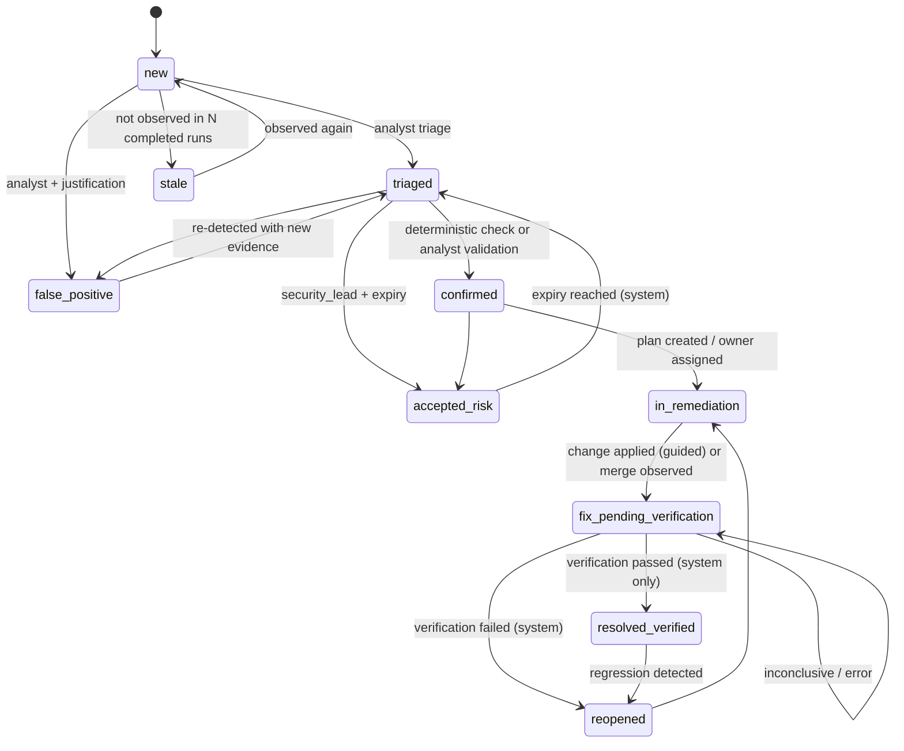

| From | To | Trigger / guard | Actor | Type |
|---|---|---|---|---|
| new | triaged | Analyst triage | analyst / security_lead | RO |
| new \| triaged | false_positive | Justification required; audited | analyst / security_lead | RO |
| triaged | confirmed | Deterministic check evidence or analyst validation | analyst / security_lead | RO |
| triaged \| confirmed | accepted_risk | Reason + expiry ≤ 365 days; analyst cannot (403) | security_lead / org_admin | RO |
| confirmed \| reopened | in_remediation | Remediation plan created or owner assigned | analyst / developer / security_lead | RO |
| in_remediation | fix_pending_verification | Merge observed or guided fix marked applied | system / developer | RO |
| fix_pending_verification | resolved_verified | Verification passed (system-only; no user path, 422 otherwise) | system | RT |
| fix_pending_verification | reopened | Verification failed | system | RT |
| fix_pending_verification | (unchanged) | Verification inconclusive / error / not_run — never mapped to passed | system | RT |
| resolved_verified | reopened | Regression detected on later run | system | RT |
| accepted_risk | triaged | Expiry reached | system | RO |
| false_positive | triaged | Re-detected with new evidence hash | system | RO |
| new ↔ stale |  | Not observed in N completed runs / observed again | system | RO |

### Remediation

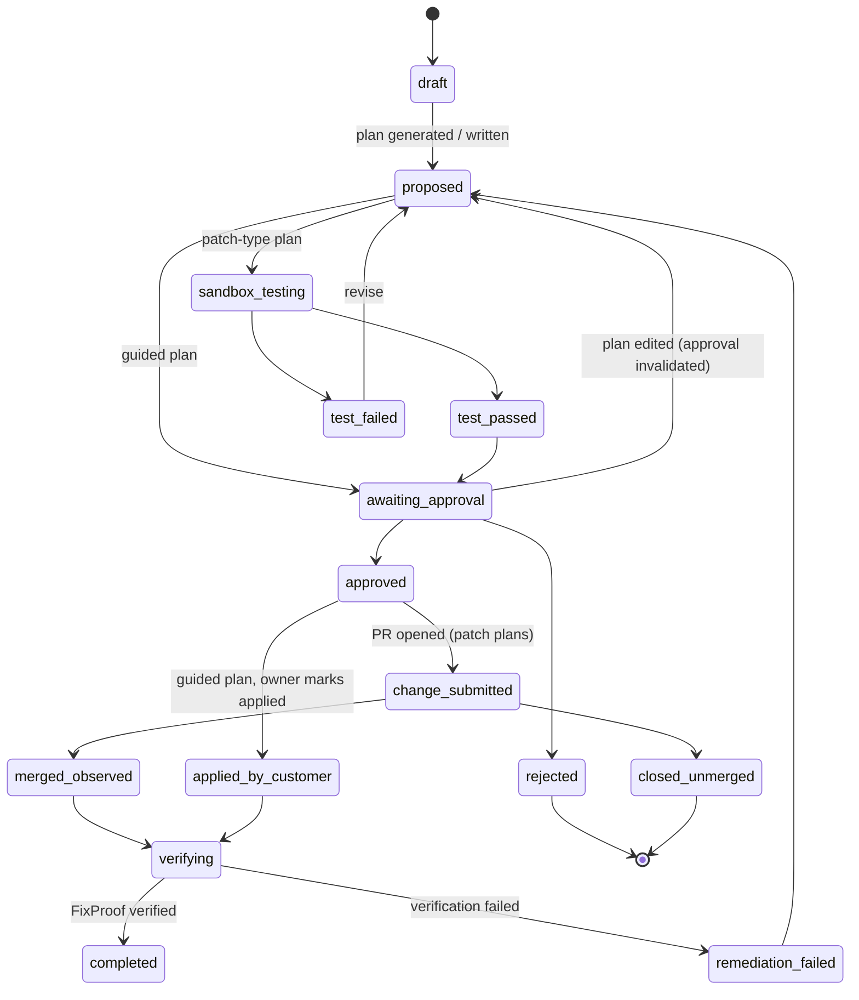

| From | To | Trigger / guard | Actor | Type |
|---|---|---|---|---|
| draft | proposed | Plan generated (AI optional) or written | developer / analyst | RO |
| proposed | sandbox_testing | Patch-type plan submitted for test | developer | RO |
| sandbox_testing | test_passed \| test_failed | Sandbox result; test_failed reasons: apply_failed, tests_failed, timeout (20 min) | service | RO |
| test_failed | proposed | Revise patch | developer | RO |
| proposed (guided) \| test_passed | awaiting_approval | Approval requested; subject hash computed | developer / analyst | RO |
| awaiting_approval | approved \| rejected | Eligible approver with step-up MFA | approver / security_lead / org_admin | AR |
| awaiting_approval | proposed | Plan edited → approval invalidated | developer | RO |
| approved | change_submitted | Pull request opened in customer repository; approval consumed | service | TM + AR |
| approved | applied_by_customer | Guided plan: owner marks change applied outside RuyaShield | developer / org_admin | RO |
| change_submitted | merged_observed \| closed_unmerged | Repository webhook/poll; humans merge outside RuyaShield | system | RO |
| merged_observed \| applied_by_customer | verifying | Verification scheduled | system | RT |
| verifying | completed \| remediation_failed | FixProof verified / verification failed | system | RT |
| remediation_failed | proposed | Revise | developer | RO |

### Approval

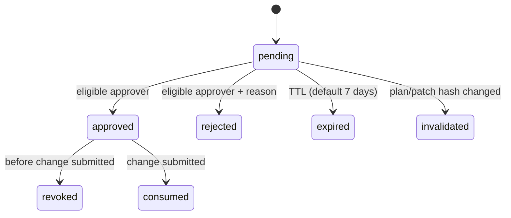

| From | To | Trigger / guard | Actor | Type |
|---|---|---|---|---|
| pending | approved | Eligible approver ≠ requester (unless single-approver policy D-08), step-up auth_time ≤ 15 min, subject hash matches | approver | AR |
| pending | rejected | Eligible approver + reason | approver | AR |
| pending | expired | TTL reached (default 7 days) | system | RO |
| pending | invalidated | Plan/patch content hash changed | system | RO |
| approved | revoked | Revoked before change submitted | approver / org_admin | RO |
| approved | consumed | Change submitted (single use) | system | TM |

### Verification run

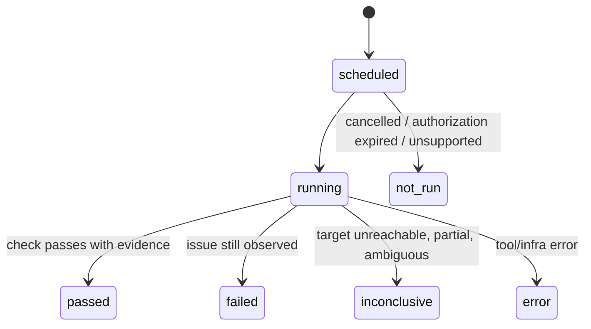

| From | To | Trigger / guard | Actor | Type |
|---|---|---|---|---|
| scheduled | running | Worker lease; same check_definition version as original detection | service | RT |
| scheduled | not_run | Cancelled, authorization expired or check unsupported | system | RO |
| running | passed | Check passes with captured evidence | service | RT |
| running | failed | Issue still observed | service | RT |
| running | inconclusive | Target unreachable, partial or ambiguous result | service | RT |
| running | error | Tool / infrastructure error | service | RT |

### Asset verification

| From | To | Trigger / guard | Actor | Type |
|---|---|---|---|---|
| unverified | verified | DNS TXT / HTTP well-known file / meta tag proof found, or attestation recorded (attestation allows P only unless policy allows A1) | org_admin / security_lead | RT |
| verified | lapsed | Re-verification fails twice over 72 h; active checks blocked | system | RT |
| lapsed | verified | Proof restored | system | RT |

### Assessment launch pre-checks

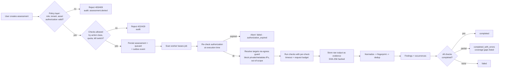

### Remediation to pull request

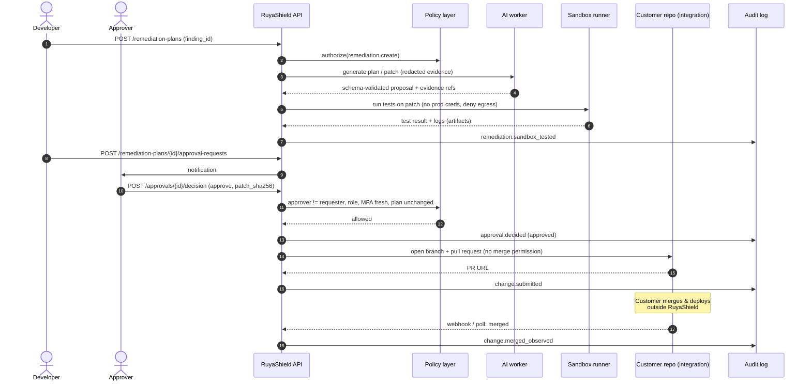

## 7. AI gateway

| ID | Use case | Status | Inputs | Output | Fallback / enforcement | Story |
|---|---|---|---|---|---|---|
| AI-UC-01 | Explain a finding (technical + plain language) | Optional | Finding, evidence items (redacted), check definition | ai.analysis v1 (explanation) | Deterministic template text from check definition | RS-AI-002 |
| AI-UC-02 | Root-cause hypotheses | Optional | Finding, evidence, approved customer context | ai.analysis v1 (claims typed inference) | No hypothesis shown; "AI unavailable" banner | RS-AI-003 |
| AI-UC-03 | Remediation guidance / proposed patch | Optional | Finding, evidence, repo file excerpts (redacted) if connected | ai.analysis v1 (recommendation) / patch diff | Check-definition remediation guidance; human-written patch | RS-AI-004 |
| AI-UC-04 | Diagnostic plan (suggest follow-up checks) | Optional | Finding, scope, check catalogue (P/A1 only) | List of check_definition IDs — never commands | User picks checks manually | RS-AI-007 |
| AI-UC-05 | Report narrative drafting | Optional | Assessment summary, verified FixProof records | Draft text; human edits before export | Template report | RS-DASH-003 |
| AI-UC-06 | Prompt-injection screening of untrusted content | Required (when AI is used) | Untrusted spans | Classifier label; deterministic delimiting regardless | Treat all as untrusted (default) | RS-AI-005 |
| AI-UC-07 | Deciding a finding is resolved / verified | Prohibited | — | — | Only deterministic verification runs can set resolved_verified | RS-FIXP-002 |
| AI-UC-08 | Selecting targets, expanding scope, launching scans | Prohibited | — | — | Human launch within approved scope only | RS-SCOPE-001 |
| AI-UC-09 | Approving, merging, deploying or executing commands | Prohibited | — | — | Human approver; PR-only; sandbox runs only fixed test commands | RS-APPR-002 |
| AI-UC-10 | Creating or editing findings / scan results | Prohibited | — | — | Findings come only from check runs | RS-FIND-001 |
| AI-UC-11 | Claiming compromise or guaranteeing security | Prohibited | — | — | Four-way classification set by a human | RS-AI-003 |

| Claim type | Definition | Validation |
|---|---|---|
| observation | A fact directly present in a cited evidence item (e.g. header absent in response evidence EV-…). | Must cite ≥ 1 evidence_item_id that contains the fact; validator checks the ID belongs to the finding. |
| inference | A reasoned conclusion from observations (e.g. likely cause is CDN config). | Must cite the observations it relies on; displayed as "Hypothesis"; confidence label ≤ likely. |
| recommendation | A suggested action (e.g. add HSTS header). | Must reference the finding and include a verification check ID; requires human acceptance; never executed by AI. |

| Control | Specification | Label |
|---|---|---|
| Inputs & provenance | Only data from the tenant's own findings, evidence and approved context; each input recorded as {source_type, id, sha256}. input_hash = SHA-256 of canonical input bundle. | Recommended addition |
| Output schema | JSON schema ai.analysis v1 validated server-side; invalid → one retry with repair prompt → else stored as failed, fallback shown. | Confirmed from existing PRD (structured outputs) + Recommended addition |
| Typing | Every claim typed observation / inference / recommendation; untyped or uncited claims are dropped and counted. | Recommended addition |
| Untrusted content | Website content, repository content, logs and uploads are wrapped in delimited, labelled data blocks; system policy never in the same channel; model has no tools; output never executed. | Confirmed from existing PRD |
| Redaction | Secrets (API keys, tokens, passwords, private keys), cookies, Authorization headers, emails and IPs of end users redacted before sending; redaction patterns versioned (D-15). | Confirmed from existing PRD (minimize) + Recommended addition |
| Fallback | Core workflow (scan → finding → remediation → verification → FixProof) works with AI disabled per org or globally. | Recommended addition |
| Cost | Per-request token cap, per-org monthly AI budget from plan, circuit breaker on provider errors; usage metered idempotently. | Recommended addition |
| Versioning | prompt_template_id@version, model provider/model ID, schema version, redaction version stored on every ai_analyses row; changes go through eval gate. | Recommended addition |
| Evaluation | Golden set per use case: factual accuracy, evidence traceability, unsafe-action attempts, injection resistance, leakage, regressions; gate before each model/prompt release (TC-AIEVAL-*). | Confirmed from existing PRD |
| Human review | AI output labelled "AI-generated — review before use"; recommendations need explicit acceptance; critical findings need analyst triage regardless. | Confirmed from existing PRD |
| Provider | Provider-agnostic gateway; provider choice D-07; no customer data used for provider training (contractual requirement to confirm). | Confirmed from existing PRD / Open question |

## 8. FixProof

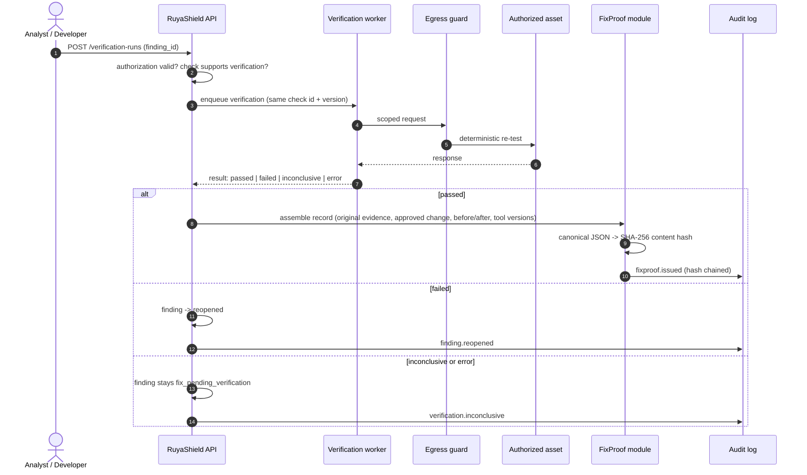

| Section | Fields |
|---|---|
| Original finding | finding_id, fingerprint, title, severity, confidence, first_seen, check_definition id@version |
| Original evidence | evidence_item ids + sha256 (content stored in private S3, redacted) |
| Remediation | remediation_plan id, type (guided/patch), code_change id, PR URL, merge commit SHA (if observed) |
| Approval | approval id, approver user id, decided_at, subject_sha256, policy (two-person / single-approver) |
| Verification | verification_run ids, result per run, same check version flag, evidence ids + sha256, started/finished timestamps |
| Status & limits | overall status (verified / partially_verified / failed / unverified), coverage note, limitations text ("verifies only the listed checks at the stated time") |
| Integrity | content_sha256 over RFC 8785 canonical JSON; prev_record_hash (hash chain per org); export signature (HMAC/KMS-sign, D-11 for WORM) |

| Run results | FixProof status | Finding outcome | Note |
|---|---|---|---|
| all runs passed | verified | resolved_verified | Only path to "verified". |
| ≥1 passed, none failed, some inconclusive/error/not_run | partially_verified | fix_pending_verification (unchanged) | Shown amber; never displayed as verified. |
| any run failed | failed | reopened | Remediation → remediation_failed; owner notified. |
| none passed and none failed | unverified | fix_pending_verification (unchanged) | Retry allowed; reason shown. |

- A FixProof record is created only from a completed verification evaluation; it is never edited — a new record supersedes it (supersedes_id) on re-verification or regression.
- Failed, inconclusive, error and not_run results are never represented as passed in UI, API, export or report.
- Records are tamper-evident (hash chain + content hash, verifiable offline from the JSON export). No immutability or WORM claim is made unless D-11 (S3 Object Lock) is implemented.
- Regression on a resolved_verified finding reopens it and marks the latest FixProof superseded (regression); the original record is retained unchanged.
- Export: JSON (canonical, with hashes) and PDF (human-readable, with verification instructions). Exports are audited (fixproof.exported).
- Retention: kept for the life of the organization plus the retention period in §12.3 (assumption: 3 years after finding closure); deletion only via org deletion workflow, audited.

## 9. Sandbox and egress guard

| Aspect | Specification | Label |
|---|---|---|
| Runtime | Ephemeral container with gVisor or Firecracker microVM (D-05); fresh per run; destroyed after. | Recommended addition |
| Limits | 2 vCPU, 4 GB RAM, 10 GB disk, 20 min wall clock (assumptions; tune in P5). | Recommended addition |
| Network | Deny by default; allowlist package registries via caching proxy; no customer production hosts; no metadata endpoints. | Confirmed from existing PRD + Recommended addition |
| Credentials | None. Repository checkout via short-lived read token used outside the sandbox; code copied in. | Confirmed from existing PRD |
| Commands | Fixed, customer-configured install/test commands from repo config reviewed in RuyaShield; never from model output. | Confirmed from existing PRD |
| Artifacts | Only test report, logs (redacted, size-capped) and diff hash leave the sandbox. | Recommended addition |
| Failure | Any limit breach → test_failed with reason; never test_passed. | Recommended addition |

**Egress guard rules**

- Resolve hostname once, pin the IP for the request, and re-check on redirect (max 5 redirects, each re-validated).
- Deny RFC 1918, loopback, link-local, CGNAT, multicast, IPv6 ULA/link-local, cloud metadata (169.254.169.254, fd00:ec2::254) and RuyaShield own ranges.
- Allow only hosts in the assessment scope snapshot (exact host or verified subdomain per policy).
- Enforce per-assessment request budget, concurrency, rate (default 5 req/s — assumption) and per-check timeouts.
- Check kill switch state before each batch; refuse when engaged.
- Log every denied request as egress.denied with reason; denials never silently retried to another IP.

## 10. Data model

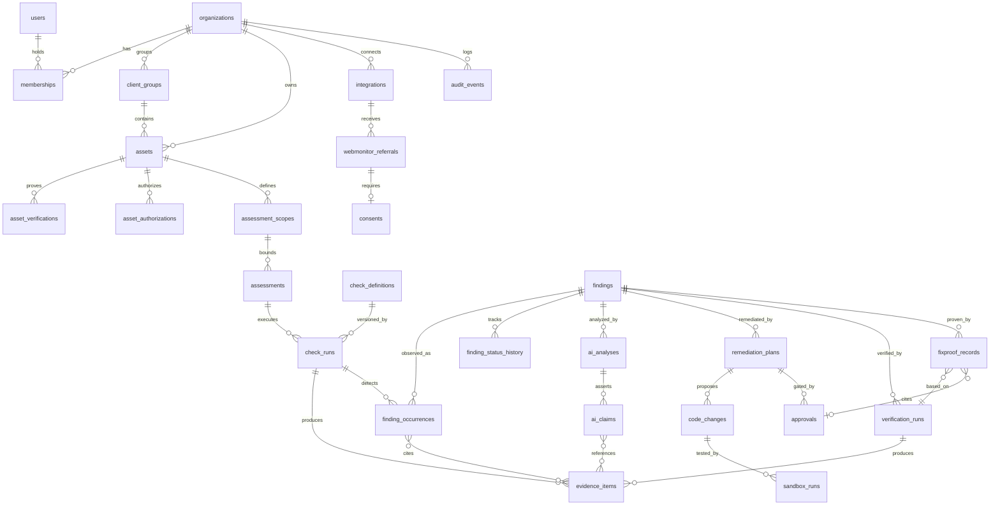

| Table | Purpose | Key columns | Tenancy | Retention (assumption) |
|---|---|---|---|---|
| organizations | Tenant root | id, name, plan, kill_switch, single_approver_policy, created_at | root | Org life + 30 days |
| users | Identity (IdP subject) | id, idp_sub, email, mfa_enrolled, disabled_at | global | Account life |
| memberships | User ↔ org role | org_id, user_id, role, client_group_ids[], invited_by, status | org_id RLS | Org life |
| client_groups | Agency client separation | org_id, id, name | org_id RLS | Org life |
| assets | Authorized targets | org_id, id, client_group_id, kind (domain/url/api), host, verification_status | org_id RLS | Org life |
| asset_verifications | Ownership proofs | org_id, asset_id, method, token_hash, verified_at, last_checked_at, failures | org_id RLS | Org life |
| asset_authorizations | Documented attestation | org_id, asset_id, attested_by, text_version, document_ref, expires_at | org_id RLS | Org life + 3 y |
| check_definitions | Versioned check catalogue | id, version, action_class (P/A1/A2/X), engine, params_schema | global | Permanent |
| assessment_scopes | Versioned scope | org_id, id, asset_id, version, check_ids[], limits, approved_by | org_id RLS | Org life |
| assessments | Runs | org_id, id, scope_id, scope_version, state, reason, coverage_pct, idempotency_key | org_id RLS | 3 y |
| check_runs | Per-check execution | org_id, assessment_id, check_definition_id@version, state, started_at, finished_at | org_id RLS | 3 y |
| evidence_items | Evidence metadata (content in S3) | org_id, id, kind, s3_key, sha256, redaction_version, size | org_id RLS | 1 y raw / hash kept 3 y |
| findings | Deduplicated issues | org_id, id, asset_id, fingerprint, state, severity, confidence, owner_id, due_at | org_id RLS | 3 y after closure |
| finding_occurrences | Detections | org_id, finding_id, check_run_id, observed_at | org_id RLS | 3 y |
| finding_status_history | Transitions | org_id, finding_id, from, to, actor, reason, at | org_id RLS | 3 y |
| risk_acceptances | Accepted risk | org_id, finding_id, accepted_by, reason, expires_at | org_id RLS | 3 y |
| ai_analyses | AI outputs + provenance | org_id, id, finding_id, use_case, prompt_id@ver, model, input_hash, status, tokens, cost | org_id RLS | 1 y |
| ai_claims | Typed claims | org_id, analysis_id, type, text, evidence_ids[], confidence_label | org_id RLS | 1 y |
| remediation_plans | Plans | org_id, id, finding_id, type, state, content_sha256 | org_id RLS | 3 y |
| code_changes | Proposed diffs | org_id, id, plan_id, diff_s3_key, diff_sha256, pr_url, merge_sha | org_id RLS | 3 y |
| sandbox_runs | Patch tests | org_id, id, code_change_id, result, reason, limits, report_s3_key | org_id RLS | 1 y |
| approvals | Content-bound approvals | org_id, id, subject_type, subject_id, subject_sha256, requester_id, approver_id, state, auth_time, expires_at | org_id RLS | 3 y |
| verification_runs | Verification | org_id, id, finding_id, check_definition_id@version, result, reason | org_id RLS | 3 y |
| fixproof_records | FixProof | org_id, id, finding_id, status, content_json, content_sha256, prev_hash, supersedes_id | org_id RLS | Org life + 3 y |
| integrations | Repo / WebMonitor connections | org_id, id, provider, scopes, secret_ref (Secrets Manager ARN) | org_id RLS | Until disconnected |
| webmonitor_referrals | Provisional handoffs | org_id, id, external_ref, signal_type, host, nonce, consumed_at | org_id RLS | 1 y |
| consents | Assessment/charge consent | org_id, id, user_id, subject, text_version, at | org_id RLS | 3 y |
| usage_records | Quota metering | org_id, id, metric, quantity, idempotency_key, period | org_id RLS | 3 y |
| outbox | Event outbox | id, org_id, event_type, payload, published_at | org_id RLS | 7 days after publish |
| audit_events | Append-only audit | org_id, seq, id, actor, action, subject, outcome, at, prev_hash, hash | org_id RLS; INSERT only | 3 y (assumption) |

### Retention

| Data | Retention | Reason | Label |
|---|---|---|---|
| Raw evidence content (S3) | 1 year after capture | Hash and metadata kept with finding | Recommended addition — assumption |
| Findings, history, FixProof | 3 years after finding closure; FixProof for org life + 3 y | Client-proof value | Recommended addition — assumption |
| AI inputs/outputs | 1 year; inputs stored only as hashes + references | Minimization | Recommended addition — assumption |
| Sandbox logs and reports | 1 year |  | Recommended addition — assumption |
| Audit events | 3 years | Investigations | Recommended addition — assumption |
| Org deletion | Soft delete 30 days, then purge (except legally required records) | Customer request | Recommended addition — Open question (legal review) |
| Backups | 35 days point-in-time | Recovery | Recommended addition — assumption |

### Audit event catalogue

| Event types | Epic |
|---|---|
| auth.login / auth.login_failed / auth.logout | IAM |
| auth.step_up | IAM |
| authz.denied | IAM |
| org.created / org.updated / org.kill_switch_changed | IAM, ASSESS |
| member.invited / member.role_changed / member.removed | IAM |
| asset.created / asset.verified / asset.lapsed / asset.attested | ASSET |
| scope.created / scope.version_approved | SCOPE |
| assessment.launched / assessment.rejected / assessment.cancelled / assessment.completed | ASSESS |
| egress.denied | ASSESS |
| finding.created / finding.transitioned / finding.assigned | FIND, COLLAB |
| finding.false_positive / risk.accepted / risk.expired | RISK |
| evidence.accessed / evidence.exported | FIND |
| ai.analysis_requested / ai.analysis_failed / ai.injection_detected | AI |
| remediation.created / sandbox.run_completed | REMED |
| approval.requested / approval.decided / approval.invalidated / approval.revoked | APPR |
| change.pr_opened / change.merge_observed | REMED |
| verification.completed / fixproof.created / fixproof.exported | FIXP |
| integration.connected / integration.disconnected | REMED, WMON |
| webmonitor.handoff_received / webmonitor.handoff_rejected | WMON |
| operator.break_glass / operator.action | ADMIN |
| audit.exported / audit.chain_verified | AUDIT |
| retention.purged | PLAT |

## 11. API conventions and endpoints

- Base path /v1; JSON; org scoping via path /v1/orgs/{orgId}/… — server re-checks membership (path value never trusted alone).
- Mutations require Idempotency-Key header (24 h retention); replay returns the original response.
- Errors: RFC 9457 problem+json with stable "code" (e.g. transition_not_allowed, approval_required, kill_switch_engaged, quota_exceeded, scope_violation).
- Status codes: 400 validation, 401 unauthenticated, 403 forbidden, 404 not found (also for other tenants' IDs), 409 conflict/state, 410 expired, 422 transition_not_allowed / prohibited, 423 kill switch, 429 rate/quota.
- Cursor pagination (?cursor=&limit≤100); ISO-8601 UTC timestamps; IDs are prefixed ULIDs (asm_, fnd_, …).
- All endpoints below are proposed contracts for implementation, not an existing API.

| Method | Path | Purpose | Roles | Story |
|---|---|---|---|---|
| POST | /v1/orgs | Create organization | any signed-in user | RS-IAM-002 |
| POST | /v1/orgs/{orgId}/invites | Invite member with role | org_admin | RS-IAM-003 |
| POST | /v1/orgs/{orgId}/assets | Register asset | org_admin, security_lead | RS-ASSET-001 |
| POST | /v1/orgs/{orgId}/assets/{assetId}/verifications | Start / check ownership verification | org_admin, security_lead | RS-ASSET-002 |
| POST | /v1/orgs/{orgId}/assets/{assetId}/authorizations | Record attestation | org_admin | RS-ASSET-003 |
| POST | /v1/orgs/{orgId}/scopes | Create scope version | security_lead | RS-SCOPE-001 |
| POST | /v1/orgs/{orgId}/assessments | Launch assessment | analyst, security_lead | RS-ASSESS-001 |
| POST | /v1/orgs/{orgId}/assessments/{id}:cancel | Cancel assessment | analyst, security_lead | RS-ASSESS-004 |
| PUT | /v1/orgs/{orgId}/kill-switch | Engage / release org kill switch (step-up) | org_admin | RS-ASSESS-007 |
| GET | /v1/orgs/{orgId}/findings | List findings with filters | all roles (viewer read) | RS-FIND-005 |
| POST | /v1/orgs/{orgId}/findings/{id}/transitions | Request state transition | per transition table | RS-FIND-004 |
| POST | /v1/orgs/{orgId}/findings/{id}/risk-acceptances | Accept risk with expiry | security_lead, org_admin | RS-RISK-002 |
| POST | /v1/orgs/{orgId}/findings/{id}/ai-analyses | Request AI analysis (async) | analyst, developer, security_lead | RS-AI-002 |
| POST | /v1/orgs/{orgId}/remediation-plans | Create remediation plan | developer, analyst | RS-REMED-001 |
| POST | /v1/orgs/{orgId}/code-changes/{id}/sandbox-runs | Run patch in sandbox | developer | RS-REMED-003 |
| POST | /v1/orgs/{orgId}/approvals | Request approval (returns subject_sha256) | developer, analyst | RS-APPR-001 |
| POST | /v1/orgs/{orgId}/approvals/{id}/decision | Approve / reject (step-up) | approver, security_lead, org_admin | RS-APPR-002 |
| POST | /v1/orgs/{orgId}/findings/{id}/verification-runs | Schedule verification | system / analyst | RS-FIXP-001 |
| GET | /v1/orgs/{orgId}/fixproofs/{id}/export?format=json\|pdf | Export FixProof | all except service | RS-FIXP-004 |
| GET | /v1/orgs/{orgId}/audit-events | Audit viewer / export | org_admin, security_lead | RS-AUDIT-003 |
| POST | /v1/integrations/webmonitor/handoffs | PROVISIONAL inbound handoff (adapter; contract per DEP-WM-01) | signed token | RS-WMON-001 |

### Examples

**Launch assessment — request**

```jsonc
POST /v1/orgs/org_01J.../assessments
Idempotency-Key: 6f1c2b9e-...
{
  "scope_id": "scp_01J8Z...",
  "scope_version": 3,
  "requested_check_ids": ["tls.cert_expiry@2", "http.security_headers@1", "dns.email_posture@1"]
}
```

**Launch assessment — 202 response**

```jsonc
{
  "id": "asm_01J9A...",
  "state": "queued",
  "scope_version": 3,
  "checks": [{"id": "tls.cert_expiry@2", "action_class": "A1"}, {"id": "http.security_headers@1", "action_class": "A1"},
             {"id": "dns.email_posture@1", "action_class": "P"}],
  "created_at": "2026-10-29T09:12:44Z"
}
```

**Launch blocked — 423 kill switch**

```jsonc
{
  "type": "https://docs.ruyashield.example/errors/kill_switch_engaged",
  "title": "Assessments are paused",
  "status": 423,
  "code": "kill_switch_engaged",
  "detail": "The organization kill switch is engaged. No target traffic will be sent."
}
```

**ai.analysis v1 (stored output)**

```jsonc
{
  "schema": "ai.analysis/v1",
  "analysis_id": "aia_01J9C...",
  "finding_id": "fnd_01J9B...",
  "use_case": "explain_finding",
  "provenance": {"prompt": "explain_finding@4", "model": "<provider>/<model-id>", "redaction": "r3",
                 "input_hash": "sha256:9c1e...", "inputs": [{"type": "evidence_item", "id": "evi_01J9B...", "sha256": "sha256:51aa..."}]},
  "claims": [
    {"type": "observation", "text": "The response does not include a Strict-Transport-Security header.", "evidence_ids": ["evi_01J9B..."]},
    {"type": "inference", "text": "HSTS is likely not configured at the CDN layer.", "relies_on": [0], "confidence_label": "likely"},
    {"type": "recommendation", "text": "Add Strict-Transport-Security: max-age=31536000; includeSubDomains.", "verification_check_id": "http.security_headers@1", "requires_human_acceptance": true}
  ],
  "unknowns": ["Whether all subdomains serve HTTPS has not been checked."],
  "label": "AI-generated — review before use"
}
```

**Approval decision — request**

```jsonc
POST /v1/orgs/org_01J.../approvals/apr_01J9D.../decision
Idempotency-Key: 0b7d...
{ "decision": "approved", "subject_sha256": "sha256:4be2...", "comment": "Header change only; tests pass." }
// server rejects with 409 subject_mismatch if hash differs, 401 step_up_required if auth_time > 15 min,
// 403 self_approval_forbidden if approver == requester and single-approver policy is off
```

**Verification run — completed**

```jsonc
{
  "id": "vrf_01J9F...",
  "finding_id": "fnd_01J9B...",
  "check": "http.security_headers@1",
  "same_version_as_detection": true,
  "result": "passed",
  "evidence_ids": ["evi_01J9F..."],
  "started_at": "2026-10-29T11:02:10Z",
  "finished_at": "2026-10-29T11:02:14Z"
}
```

**FixProof export (JSON, abridged)**

```jsonc
{
  "schema": "fixproof/v1",
  "id": "fxp_01J9G...",
  "status": "verified",
  "finding": {"id": "fnd_01J9B...", "fingerprint": "sha256:aa10...", "severity": "medium", "check": "http.security_headers@1"},
  "remediation": {"plan_id": "rem_01J9D...", "type": "patch", "pr_url": "https://<repo-host>/<org>/<repo>/pull/42", "merge_sha": "3f9c..."},
  "approval": {"id": "apr_01J9D...", "approver": "usr_01H...", "subject_sha256": "sha256:4be2...", "policy": "two_person"},
  "verification": [{"id": "vrf_01J9F...", "result": "passed"}],
  "limitations": "Verifies only the listed checks against the listed asset at the stated time.",
  "integrity": {"content_sha256": "sha256:7d02...", "prev_record_hash": "sha256:c8e1...", "canonicalization": "RFC8785"}
}
```

**WebMonitor handoff (PROVISIONAL)**

```jsonc
// Provisional adapter payload — not a WebMonitor API. Replace per DEP-WM-01.
{
  "referral_id": "wm-ref-…",
  "signal_type": "tls_certificate_expiring",
  "host": "client-site.example",
  "observed_at": "2026-10-28T22:00:00Z",
  "summary": "Certificate expires in 9 days",
  "nonce": "…", "exp": 1793270000
}
```

## 12. Events

| Event | Producer | Consumers | Key payload |
|---|---|---|---|
| assessment.requested | assessments | orchestrator | assessment_id, org_id, scope_version, idempotency_key |
| check_run.dispatched | orchestrator | scan worker | check_run_id, check_definition@version, scope_snapshot_hash, budget |
| check_run.completed | scan worker | findings, assessments | check_run_id, state, evidence_ids[], raw_result_ref |
| finding.created / finding.transitioned | findings | notifications, ai (optional), dashboard | finding_id, from, to, actor |
| ai.analysis.requested / completed | ai | findings UI | analysis_id, status, schema_version |
| sandbox.run.requested / completed | remediation | sandbox runner / remediation | sandbox_run_id, diff_sha256, result, reason |
| approval.decided | approvals | remediation | approval_id, decision, subject_sha256 |
| change.merge_observed | integrations | remediation, verification | code_change_id, merge_sha |
| verification.completed | verification | findings, fixproof, notifications | verification_run_id, result |
| fixproof.created | verification | notifications, integrations (WebMonitor link) | fixproof_id, status, content_sha256 |
| org.kill_switch_changed | iam | orchestrator, workers | org_id, engaged, actor |

**Envelope**

```json
{
  "event_id": "evt_01J9...", "type": "verification.completed", "version": 1,
  "org_id": "org_01J...", "occurred_at": "2026-10-29T11:02:14Z",
  "idempotency_key": "vrf_01J9F...:completed", "trace_id": "4bf92f35...",
  "data": { "verification_run_id": "vrf_01J9F...", "finding_id": "fnd_01J9B...", "result": "passed" }
}
```

Delivery is at-least-once through the transactional outbox. Consumers dedupe on `idempotency_key`, and the dedupe record is kept for 7 days (assumption).

## 13. WebMonitor adapter (provisional)

| Aspect | Specification | Label |
|---|---|---|
| Dependency | DEP-WM-01: WebMonitor API, payload, authentication and event contract — not yet provided. Everything below is a provisional RuyaShield-side adapter interface, not a WebMonitor endpoint. | Open question |
| Direction | Inbound referral handoff (WebMonitor → RuyaShield) and outbound result linkage (RuyaShield → WebMonitor) behind a WebMonitorAdapter interface with a stub implementation for tests. | Recommended addition |
| Authentication | Provisional: signed handoff token (asymmetric signature, ≤ 10 min TTL, single-use nonce) — to be replaced by the agreed mechanism. | Recommended addition / Open question |
| Minimal context | Only: referral id, signal type, affected URL/host, observed_at, short description. No WebMonitor credentials, page content or end-user data. | Confirmed from existing PRD (FR-042) |
| Consent | User must sign in, select org, confirm asset verification/attestation and explicitly consent to the assessment (and to any charge). No scan starts from a handoff alone. | Confirmed from existing PRD (FR-041) |
| Result linkage | Outbound status only: referral id, assessment status, counts by severity, FixProof status. P1. | Confirmed from existing PRD (FR-043) |
| Attribution | referral_events table for click-through / conversion metrics. P1. | Confirmed from existing PRD (FR-044) |

```ts
interface WebMonitorAdapter {
  // PROVISIONAL — shape owned by RuyaShield; real transport defined by DEP-WM-01
  verifyHandoff(token: string): Promise<VerifiedReferral>;      // rejects expired, replayed, bad signature
  publishResult(link: ReferralResultLink): Promise<void>;        // idempotent on (referral_id, status_version)
}
type VerifiedReferral = { referralId: string; signalType: string; host: string; observedAt: string; summary: string };
type ReferralResultLink = { referralId: string; assessmentId: string; status: string;
  severityCounts: Record<'critical'|'high'|'medium'|'low'|'info', number>; fixproofStatus?: string; statusVersion: number };
```

## 14. Open technical decisions

| ID | Decision | Recommendation | Label | Owner | Needed by | Impact |
|---|---|---|---|---|---|---|
| D-01 | First scanner engine | Evaluate established engines (e.g. OWASP ZAP baseline/passive mode, ProjectDiscovery Nuclei with curated non-intrusive templates, testssl.sh) for licensing, coverage of MVP checks, determinism for verification, and safe modes. Select one primary engine plus native TLS/header/DNS checks. | Open question | Tech lead + security engineer | Gate G0 | Blocks ASSESS check catalogue |
| D-02 | Database access layer | Prisma or Drizzle — choose based on RLS/session-variable support and migration tooling. Provisional: Drizzle (simpler SQL control for RLS). | Open question | Tech lead | Gate G0 | FOUNDATION schema |
| D-03 | Queue technology | AWS SQS + DLQ (as v1.1) with transactional outbox. Confirm. | Confirmed from existing PRD | Tech lead | Gate G0 | ASSESS, REMED |
| D-04 | Identity provider | Established provider supporting OIDC, MFA, step-up (e.g. managed auth service). Evaluate cost and data residency. | Open question | Tech lead | Gate G0 | IAM |
| D-09 | Agency model | Client groups within one org (P0) vs separate orgs per client. Recommend client groups; cross-org agency hierarchy P2. | Recommended addition | Product owner | Gate G0 | IAM |
| D-12 | Data residency | Single AWS region for pilot (provisional: ap-south-1 given INR pricing). Confirm with pilot customers. | Open question | Product owner | Gate G0 | PLAT |
| D-13 | Pilot payments | Manual invoicing during invite-only pilot; billing system post-MVP. | Recommended addition | Product owner | Gate G0 | ADMIN |
| D-05 | Worker runtime | Containers on AWS Fargate/ECS tasks for scan & verification workers; sandbox runtime needs stronger isolation (Firecracker-based microVM or gVisor). Evaluate. | Open question | DevOps + security | Gate G1 | PLAT, REMED |
| D-15 | Evidence redaction policy | Default redaction of cookies, auth headers, tokens, emails, phone numbers in stored evidence views and AI inputs. | Recommended addition | Security | Gate G2 | FIND, AI |
| D-16 | A2 checks in MVP | Recommend shipping MVP with P and A1 only; A2 framework built but no A2 checks enabled until security review. | Recommended addition | Security | Gate G2 | SCOPE |
| D-07 | AI provider(s) | Provider-agnostic adapter (v1.1). Select first provider by eval-set score, data handling terms (no training on customer data), cost. | Open question | AI engineer | Gate G3 | AI |
| D-06 | First repository provider | GitHub App first (fine-grained permissions); GitLab later. | Open question | Product owner | Gate G4 | REMED |
| D-08 | Single-approver policy | Default requires a different approver; allow org-admin opt-in "single-approver" for small agencies, flagged in audit and FixProof. | Recommended addition | Product owner + security | Gate G4 | APPR |
| D-10 | MVP recurrence monitoring | Keep FR-036/FR-043 P1 (post-MVP) unless pilot partners require it. | Open question | Product owner | Gate G5 | FIXP, WMON |
| D-11 | WORM storage for FixProof exports | Optional S3 Object Lock (compliance mode) for exported FixProof; adds cost/irreversibility. Until decided, describe as tamper-evident only. | Open question | Security + product | Gate G5 | FIXP |
| D-14 | WebMonitor contract | Obtain actual API/event contract from WebMonitor team; until then build to provisional adapter. | Open question | Product owner | Gate G6 | WMON |
